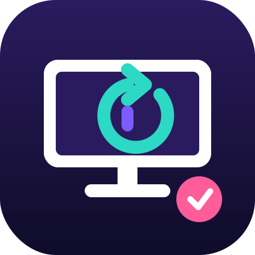
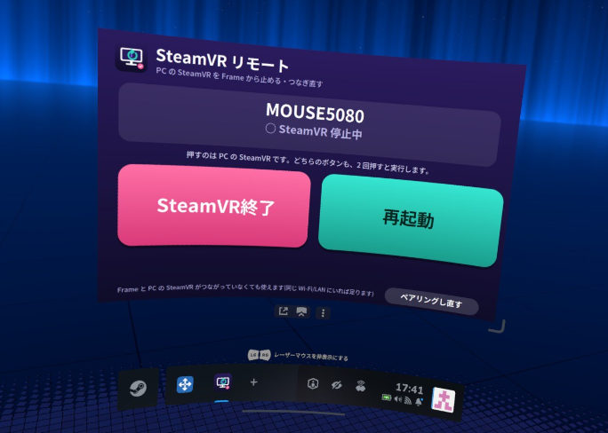

<p align="center"></p>

# frame-steamvr-remote

**Steam Frame から、PC の SteamVR を終了・再起動するアプリ**です。

PC で先に SteamVR が動いていると、あとから Frame をつなげないことがあります。
そんなとき、Frame の画面からボタン 1 つで PC の SteamVR を止めて、つなぎ直せます。

- Frame が **同じ Wi-Fi/LAN の PC を自動で見つけます**(IP アドレスの入力は不要)
- PC 側はタスクトレイに常駐する小さなアプリ(Windows のログイン時に自動で起動)
- 最初に 1 回だけ、PC の画面に出る **6 桁のコード** を Frame に入力してペアリング。以降はペアリングした Frame だけが操作できます
- 操作できるのは「SteamVR の終了」「SteamVR の再起動」「状態の確認」の 3 つだけ

> ⚠️ SteamVR を止めると、VRChat など SteamVR を使っているアプリは自分で終了します。

<p align="center"></p>

## 入れかた

### 1. PC(Windows)

1. [frame-steamvr-remote.exe](https://github.com/cympfh/frame-steamvr-remote/releases/latest/download/frame-steamvr-remote.exe) をダウンロードします(一覧は [Releases](https://github.com/cympfh/frame-steamvr-remote/releases))。
2. 好きなフォルダに置いてダブルクリック。タスクトレイ(右下の ^ の中)にアイコンが出ます。
3. 初回の Windows ファイアウォールの確認が出たら **「プライベート ネットワーク」を許可** してください。

次回からは Windows にログインすると自動で起動します(トレイのメニューでオフにできます)。

### 2. Frame

デスクトップモードの Konsole で、次を実行します(sudo は不要です)。

```sh
curl -fsSL https://raw.githubusercontent.com/cympfh/frame-steamvr-remote/main/install.sh | bash
```

入れると、SteamVR を起動したとき一緒に起動する「SteamVR リモート」のパネルが、SteamVR のダッシュボードに出ます(次の「Frame だけで開く」)。SteamVR がすでに動いていれば、その場でパネルを起動します。

## Frame だけで開く(PC の画面が見えないとき)

ヘッドセットの中で、SteamVR のダッシュボードを開くと **「SteamVR リモート」のパネル** があります。ペアリングのコードも、パネルのテンキーで入力できます。Frame と PC の SteamVR がつながっていなくても、同じ Wi-Fi/LAN にいれば使えます。

- デスクトップモードのアプリメニュー →「SteamVR リモート」でも、同じ操作の画面を開けます。
- パネルは systemd のユーザーユニット(`frame-steamvr-remote-overlay.service`)で、SteamVR と一緒に自動で起動します。止めるには `systemctl --user disable --now frame-steamvr-remote-overlay.service`。
- ダッシュボードに出ないときは、Konsole で `systemctl --user status frame-steamvr-remote-overlay.service` を見るか、上の入れかたのコマンドをもう一度実行してください。

## 使いかた

### 最初の 1 回(ペアリング)

1. PC のトレイのアイコンを右クリックして **「Frame とペアリングする(コードを表示)」** を選ぶと、6 桁のコードが出ます(2 分間有効)。
2. Frame で「SteamVR リモート」を開き、そのコードを入力します。「ペアリングしました」と出れば完了です。

### ふだん

ダッシュボードの「SteamVR リモート」を開くと、PC の名前と SteamVR の状態が出ます。

- **SteamVR終了**: PC の SteamVR をていねいに閉じ、閉じなければ SteamVR 関連のプロセスだけを終了します
- **再起動**: 終了してから SteamVR を起動し直します

**どちらも 2 回押さないと実行されません。** 1 回目でボタンが「もう一度押すと終了(5)」のように変わり、数が減っていきます。5 秒以内にもう一度押すと実行、押さなければ元に戻ります。片方を押したあとにもう片方を押すと、そちらが待機になり、先に押したほうは元に戻ります。

PC でトレイのメニューからも同じ操作ができます。

### コマンド(上級者向け)

```sh
frame-steamvr-remote status     # PC と SteamVR の状態
frame-steamvr-remote overlay    # ダッシュボードのパネルを動かす(ふだんは systemd が起動。2 つめは、いまのパネルを開くよう頼むだけ)
frame-steamvr-remote quit       # SteamVR を終了
frame-steamvr-remote restart    # SteamVR を再起動
frame-steamvr-remote pair 123456
frame-steamvr-remote discover   # LAN の PC を探す
frame-steamvr-remote forget     # Frame 側のペアリングを忘れる
```

## 安全性について

- 同じ LAN の中だけで動きます。インターネットには出ません(ルーターのポート開放はしないでください)。
- ペアリングで作った合言葉は通信路に流れません。PC では Windows の DPAPI で暗号化して保存、Frame では自分だけが読めるファイル(権限 600)に保存します。
- 毎回の操作は使い捨ての確認値つきなので、通信を盗み見て再送しても通りません。
- 終了の対象は、Steam の SteamVR フォルダにある SteamVR のプログラムだけです。

## ログと設定

| | 場所 |
|---|---|
| PC | `%APPDATA%\frame-steamvr-remote\app.log`(トレイのメニュー「ログのフォルダを開く」) |
| Frame | `~/.local/state/frame-steamvr-remote/app.log` |
| Frame の設定 | `~/.config/frame-steamvr-remote/config.json`(合言葉入り。人に見せないでください) |

ログは大きくなると自動で入れ替わります。合言葉とペアリングコードはログに書きません。

## アンインストール方法

- **PC**: トレイのメニューで「Windows の起動時に自動で起動する」をオフにして「終了」し、exe ファイルを消します。
- **Frame**: 
  ```sh
  curl -fsSL https://raw.githubusercontent.com/cympfh/frame-steamvr-remote/main/install.sh | bash -s -- --uninstall
  ```
  ファイルは消さずに `~/.local/share/frame-steamvr-remote-uninstalled/` へ移します。パネルの常駐(systemd のユーザーユニット)も止めて、自動起動を外します。

## うまくいかないとき

- **PC が見つからない**: PC のトレイにアイコンがあるか、Frame と PC が同じネットワークか確認してください。Windows のネットワークの種類が「パブリック」だとファイアウォールで止まります。「プライベート」にしてください。
- **パネルが数秒だけ消えてまた出る**: SteamVR は、`python3` で動く別のツールも同じアプリとして扱うので、そのツールがつないだり切ったりしたときに、パネルが終了の知らせを受けて、5 秒後に systemd が起動し直します。故障ではありません。
- **2 つ開かない**: パネルは 1 つしか動きません。もう一度開こうとすると、いまのパネルをダッシュボードに出します。
- **ペアリングできない**: コードは 2 分で切れ、5 回間違えると使えなくなります。もう一度トレイから「Frame とペアリングする」を選んでください。
- **ペアリングをやり直したい**: Frame の画面の「ペアリングし直す」、または PC のトレイの「ペアリングを解除する」。

## 自分でビルドする

PC 側は Rust です(Windows で `cargo build --release`、WSL からは `--target x86_64-pc-windows-gnu`)。

```sh
cargo test                                        # PC 側の単体テスト
cargo build && python3 -m unittest discover -s tests   # Frame 側のテストと、Python↔Rust の結合テスト(偽の PC を使う)
```

通信の取り決めは [docs/PROTOCOL.md](docs/PROTOCOL.md) にあります。

## ライセンス

MIT
